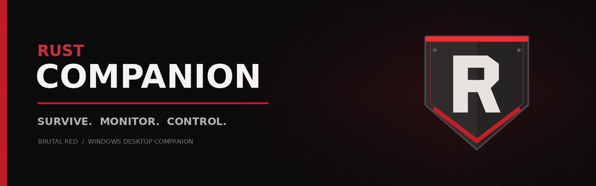

<div align="center">



# Rust Companion

**Desktop companion toolkit for Rust — server monitoring, event timers, player watchlists and Rust+ device control.**

[](https://www.microsoft.com/windows)
[](https://dotnet.microsoft.com/)
[](https://learn.microsoft.com/dotnet/desktop/wpf/)
[](#project-status)

*SURVIVE. MONITOR. CONTROL.*

</div>

---

## Overview

Rust Companion is a Windows desktop application for Rust players. It brings server discovery, player observation, event tracking, timers, notifications and Rust+ smart-device controls together in one interface.

The application uses a dark **Brutal Red** visual theme and keeps its data locally.

> **Fair-play note:** Rust Companion does not read Rust process memory, inject code into the game, automate gameplay or bypass Easy Anti-Cheat (EAC).

## Features

| Area | What it does |
|---|---|
| **Server browser** | Find Rust servers through Steam server queries and the Valve master server; save and manage servers. |
| **Player monitoring** | Watch selected Steam players, keep a local sightings/session history and organize watchlists into groups. |
| **Rust+** | Pair through Steam and the in-game pairing flow; connect to Rust+ and manage supported smart devices. |
| **Smart devices** | Work with supported Smart Switch, Smart Alarm and Storage Monitor functionality. |
| **Monument reference** | Browse a reference catalog of 36 monuments and track a selected monument's respawn observations. |
| **Event tracking** | Record Chinook, patrol helicopter and airdrop observations; maintain per-server histories and estimates where enough observations exist. |
| **Timers** | Track custom timers, Bradley respawn intervals, Deep Sea and other events. Estimates are clearly based on user observations and configured intervals. |
| **Notifications & overlay** | Configure per-event Windows and in-game overlay notifications. |
| **Decay / upkeep** | Estimate decay for up to five already-decaying building pieces from their current HP. |
| **Integrations & data** | Telegram/Discord notifications, diagnostics, database backup, import/export. |

Feature availability and data quality depend on the configured sources, server responses and user observations. Some timers and forecasts are estimates, not authoritative game data.

## Screenshots

Real application screenshots will be added here after capturing the Windows build. The repository intentionally does not use concept art as a substitute for actual product screenshots.

| Main dashboard | Server browser |
|---|---|
| _Screenshot coming soon_ | _Screenshot coming soon_ |
| Rust+ devices | Timers & events |
| _Screenshot coming soon_ | _Screenshot coming soon_ |

See [`docs/SCREENSHOTS_AND_VIDEO.md`](docs/SCREENSHOTS_AND_VIDEO.md) for the exact capture checklist and recommended recording sequence.

## Download & installation

**Requirements**
- Windows 10 or Windows 11 (x64).
- .NET 10 SDK for building from source.
- Internet connection for Steam/Rust+ and other online data sources.
- WebView2 Runtime where required by the application.

### Install from source

1. Download or clone this repository.
2. Install the [.NET 10 SDK](https://dotnet.microsoft.com/download/dotnet/10.0).
3. Close any running Rust Companion instance.
4. Run `setup.cmd` from the repository folder.
5. The script restores packages, builds the app, runs tests, publishes a self-contained Windows x64 executable and installs it under `%LOCALAPPDATA%\Programs\RustCompanion`.

The setup log is written to `setup.log`. If installation fails, attach that file when reporting the problem.

### Build and run manually

```powershell
dotnet restore RustCompanion.slnx
dotnet test tests/RustCompanion.Tests/RustCompanion.Tests.csproj -c Release
dotnet run --project src/RustCompanion.App/RustCompanion.App.csproj
```

To publish a self-contained Windows x64 build:

```powershell
dotnet publish src/RustCompanion.App/RustCompanion.App.csproj `
  -c Release -r win-x64 --self-contained true `
  -p:PublishSingleFile=true `
  -p:IncludeNativeLibrariesForSelfExtract=true `
  -o publish
```

> The desktop UI is WPF and requires Windows to run. On Linux, .NET may restore/build Windows-targeted projects with `-p:EnableWindowsTargeting=true`, but it cannot run the WPF application.

## Configuration & local data

Application data is stored under:

```text
%LOCALAPPDATA%\RustCompanion
```

This directory may contain the local SQLite database, logs and locally protected credentials. Back up this folder before manually changing or deleting application data.

Steam API and other optional integrations may require user-provided credentials. Never commit API keys, bot tokens, webhook URLs, pairing credentials, database files or personal logs to a public repository.

## Data sources & limitations

- Server and player information is obtained from supported Steam query/API sources.
- Rust+ functionality depends on successful pairing and the available Rust+ service/device responses.
- Event history and forecasts are based on recorded observations and configured intervals. They should not be treated as guaranteed spawn times.
- Player monitoring is not a live anti-cheat or admin tool; availability and accuracy depend on source responses.
- Some planned features are not implemented. Check [`docs/MERGE_NOTES.md`](docs/MERGE_NOTES.md), [`docs/RUSTPLUS.md`](docs/RUSTPLUS.md) and the relevant feature documentation for current scope.

## Security & fair play

Read [`docs/SECURITY.md`](docs/SECURITY.md) before configuring integrations. The application is designed as an external companion utility and does not modify the Rust game process or bypass EAC.

If you discover a security issue, please do not publish credentials or exploit details in a public issue. Use GitHub's private vulnerability reporting if it is enabled for this repository.

## Technology

- C# / .NET 10
- WPF + MVVM
- SQLite
- Steam server query / Steam Web API integrations
- Rust+ connectivity
- xUnit tests

## Project structure

```text
src/
  RustCompanion.App/       WPF desktop application, views, overlay and UI
  RustCompanion.Core/      Core logic, storage, monitoring and services
  RustCompanion.RustPlus/  Rust+ integration
  ThirdParty/              Bundled Rust+ API implementation
tests/
  RustCompanion.Tests/     Automated tests
docs/                      Feature, data-source and security documentation
```

## Project status

This repository represents the **stage 28 setup package** supplied for publication. The project is under active development; not every idea or planned feature is implemented. Please read the feature notes before relying on a particular workflow.

## Contributing

Bug reports and focused improvement proposals are welcome. When opening an issue, include:
- Windows version and application version.
- Steps to reproduce the issue.
- Expected and actual behavior.
- Relevant, redacted log excerpts (never include API keys, tokens or private pairing data).

## License

No license has been specified yet. Until a license is added, the source code is published for viewing but standard copyright restrictions apply; do not assume it is open source or that redistribution is permitted.

---

<div align="center">

**Rust Companion · Brutal Red**

</div>

## Documentation

Полный каталог документации: [docs/INDEX.md](docs/INDEX.md).

- [Руководство пользователя](docs/USER_GUIDE.md)
- [Архитектура](docs/ARCHITECTURE.md)
- [Руководство разработчика](docs/DEVELOPER_GUIDE.md)
- [Решение проблем](docs/TROUBLESHOOTING.md)
